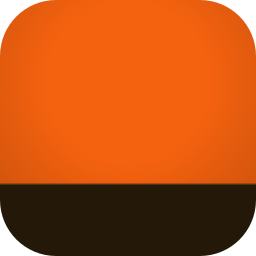

<p align="center"></p>

# baseCreator

Shared code of [LightCreator](https://github.com/michalsarna/LightCreator) (laser) and
[MillCreator](https://github.com/michalsarna/MillCreator) (CNC mill). It started as the part of LightCreator that does
not need a laser, and it grows by moving more of that part here, one piece at a time.

| Crate | What it holds |
|---|---|
| `base-core` | No GUI. Geometry, Bézier paths, arcs and fillets, snapping, boolean operations, text outlines, bitmaps and tracing, camera calibration, the **scene** (`Scene`, `Shape`, `Kind`: shapes with transforms, groups and ids), SVG and PDF reading, the clipart library, reading LightBurn projects (`lightburn`: `.lbrn2` shapes, text outlines, bitmaps and layer settings), the project file (`project`, `.cre`: the drawing plus one section per program, other programs' sections kept on save), units, GRBL settings reports, ser2net helpers |
| `base-ui` | egui parts. Interface: colour schemes (`theme`), fonts, icons (`icons`, Lucide SVGs), the translation layer (`i18n`, `texts`), menus (`menu`: entries, in-window bar, native macOS bar, the standard editing commands `StdAct`), the window frame, pop-ups and coloured buttons (`window`), small widgets, ready-made dialogs (`dialogs`: About, quick guide, update check), a Markdown viewer, unit-aware number fields, the clipart gallery (`clipart_ui`, with the 310 pictures from `assets/clipart` built in), camera helpers (feature `camera`). Editor (`editor`): the work-area canvas with tools, selection, node editing, the editing commands, the picture dialogs (import, adjust, trace), the view options window, the tool palette and the arrange bar, the Properties sections (position and size, rotation, mirror, alignment), the pieces of the control bar and the status bar, written against the `EditorHost` trait. Start screen (`start`): the logo, the name and the language / colour scheme row, and the window icon helpers |

### The editor

An application keeps an `EditorState` (selection, tool, view, grid, snapping, clipboard) and implements `EditorHost`:
where its `Scene` and its `EditorState` are, how undo works (`checkpoint`, `touch`), which layers are shown and in what
colour, the size of the work area and the units. The canvas (`EditorCanvas::canvas`), the node editing, the picture dialogs (`EditorImages`) and the
commands on the selection (`EditorCommands`) are then provided. What belongs to the application (the machine's bed,
no-go zones, a camera picture, a tool path preview, the context menu) is drawn by optional hooks of `EditorHost`
(`paint_work_area`, `paint_under_shapes`, `paint_over_shapes`, `canvas_context_menu`, ...).

### Menus and dialogs

An application lists its menus as `menu::Entry<A>` over its own action type `A` and implements `menu::MenuHost`
(which actions are enabled or ticked, their icons, how to run one). The in-window bar is `menu::menu_bar`; on macOS
`native_menu::NativeMenu` builds the system bar from the same entries. `menu::std_entries` has the entries of the
standard editing commands (`StdAct`: undo, copy, align, group, zoom, grid ...) with their labels, accelerators and
icons; `StdAct::run` carries one out on any `EditorHost`.

What is **not** here: windows that need a machine or a document with layers (device settings, the print dialog, the
camera overlay of a bed, the job check). They stay in the application.

### Plugins

Plugins add presets, clipart, translations, importers, generators (shapes from a form) and G-code postprocessors to every program: Rhai scripts in a sandbox, packs without code, installed from a folder or a zip. They can be installed from the **official list** ([baseCreator-plugins](https://github.com/michalsarna/baseCreator-plugins), with a guide for authors) inside the programs. See [docs/PLUGINS.md](docs/PLUGINS.md) and the examples in `examples/plugins/`.

## Using it

An application depends on a **tag** of this repository:

```toml
base-core = { git = "https://github.com/michalsarna/baseCreator", tag = "v0.1.0" }
base-ui   = { git = "https://github.com/michalsarna/baseCreator", tag = "v0.1.0" }
```

### Working on the base and an application at the same time

Point Cargo at your checkout of this repository. Put this in `.cargo/config.toml` of the application (add the file to
`.gitignore`) or in `~/.cargo/config.toml`, and do not commit it:

```toml
[patch."https://github.com/michalsarna/baseCreator"]
base-core = { path = "/path/to/baseCreator/crates/base-core" }
base-ui   = { path = "/path/to/baseCreator/crates/base-ui" }
```

### Texts

`tools/gen-texts.py /path/to/LightCreator` regenerates `crates/base-ui/src/texts*` (the translations of every text the
shared code shows) from LightCreator's table. A test checks that every `tr("...")` in the shared code has all 30
translations.

### Translations

`base_ui::i18n` keeps the API `tr("English text")`, `trf`, `set_lang`. The texts live in `Texts` sets: an application builds
one (`Texts::new(table, keys, files)`) and registers it with `i18n::register`; `tr` asks the registered sets in order
and then the set of the base, which is empty for now.

## Versions

Semantic versioning with tags `vX.Y.Z` (while the major number is 0, a new minor number may break things).
A change here means a new tag here first. Each application then moves its tag in a pull request of its own. A tag
here never triggers a release of an application.

Tags `-alpha.N` were used while LightCreator was being moved over; use the plain tags.

Licence: MIT OR Apache-2.0, as LightCreator. See `CREDITS.md`.

## Icon

`assets/icons/basecreator.svg` is the project icon: the orange background and the brown base of the LightCreator icon,
without the laser. MillCreator and LightCreator put their own tool on the same base. `tools/make-icons.sh
assets/icons/basecreator.svg basecreator` renders the PNGs, the `.ico` and the `.icns` (needs inkscape; the `.icns` needs macOS).
