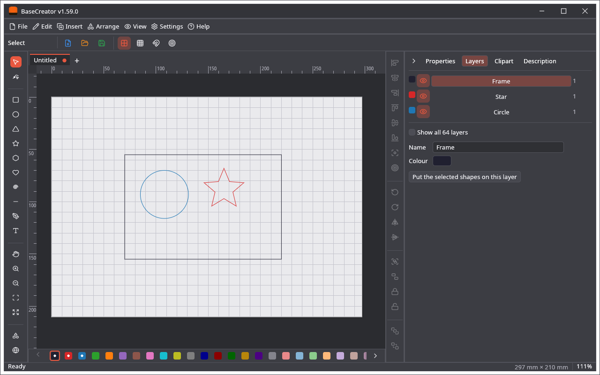

# BaseCreator

A drawing program on the libraries of this repository, with nothing of a machine: no devices, connections, G-code or camera. It writes the
same project files (`.cre`) as [LightCreator](https://github.com/michalsarna/LightCreator), [MillCreator](https://github.com/michalsarna/MillCreator)
and [PenCreator](https://github.com/michalsarna/PenCreator), so a drawing can be made here and finished for a machine there.

## Installing

Every [release](https://github.com/michalsarna/baseCreator/releases) holds these files and `SHA256SUMS.txt` to verify them:

| System | Installer / package | Archive |
|---|---|---|
| Windows 10/11 (64-bit) | `basecreator-vX.Y.Z-windows-x86_64-setup.exe` | `basecreator-vX.Y.Z-windows-x86_64.zip` |
| macOS, Apple silicon | `basecreator-vX.Y.Z-macos-arm64.dmg` | – |
| macOS, Intel | `basecreator-vX.Y.Z-macos-x86_64.dmg` | – |
| Debian / Ubuntu, x86_64 | `basecreator-vX.Y.Z-linux-amd64.deb` | `basecreator-vX.Y.Z-linux-x86_64.tar.gz` |
| Debian / Ubuntu, ARM64 | `basecreator-vX.Y.Z-linux-arm64.deb` | `basecreator-vX.Y.Z-linux-arm64.tar.gz` |

The programs are not signed by a paid developer account: macOS and Windows warn about them the first time. On macOS open the program with
right click → Open.

From source: `cargo run --release -p basecreator`.

## Versions and updates

The number of the program is the tag of this repository it was built from, for example `v1.59.0`. Not every tag is a release. What is new is in
[VERSIONS.md](../VERSIONS.md). The program looks for a newer release when it starts (*Settings → Program options…* switches that off), and
*Help → Check for updates…* looks at any time. To make a release: `gh workflow run release.yml -f tag=vX.Y.Z`, with a section for the tag in `VERSIONS.md`.

## The project file

The part of BaseCreator is the section `draw` (the page and the layers). The sections `laser`, `mill` and `pen` of the other programs are kept as
they were, and those programs keep `draw`. A project without `draw` gets the page of the last new drawing, made bigger when the drawing does not fit.

## Export

*File → Export → Export drawing as SVG…* or *DXF…* writes all the shapes, also those on hidden layers; *Export selection as…* only the selected ones.
Pictures have no outlines and are not written (trace them first).

## Plugins

*Settings → Plugins…* is the same list as in the other programs, and the plugins folder is shared. Generators and importers work here. A plugin with
postprocessors (`gcode-tools`, `gcode-dialects`) can be installed, but does nothing here.

---

## Po polsku

Program do rysowania bez żadnej części maszynowej. Zapisuje te same pliki `.cre` co LightCreator, MillCreator i PenCreator: rysunek zrobiony tutaj
otwiera się tam, a to, co należy do tamtych programów, zostaje w pliku po zapisie tutaj. Wydania są na stronie
[Releases](https://github.com/michalsarna/baseCreator/releases) i mają numery tagów tego repozytorium; program sam sprawdza przy starcie, czy jest nowsza
wersja. Zamiast pola roboczego maszyny jest strona (*Plik → Ustawienia strony…*). Wtyczki generujące kształty i importery działają; wtyczki z
postprocesorami G-code można zainstalować, ale tutaj nic nie robią.
