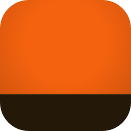
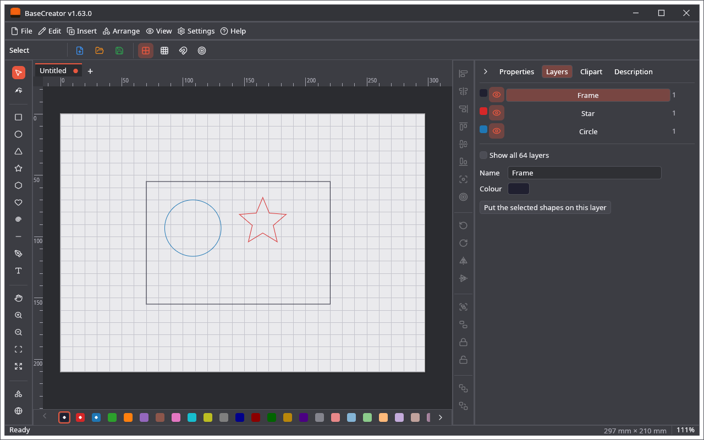

🌐 [English](Home) · [Polski](Home-PL) · [简体中文](Home-ZH) · **한국어**

> ⚠️ 이 페이지는 영어판을 기계 번역한 것으로, 부정확한 부분이 있을 수 있습니다. 의심스러우면 [영어판](Home)을 기준으로 하십시오. 수정 제안을 환영합니다.

# BaseCreator

Rust로 작성된 오픈 소스 드로잉 프로그램으로, 기계와 관련된 기능은 전혀 없습니다. 장치, 연결, G-code, 카메라가 없습니다. [LightCreator](https://github.com/michalsarna/LightCreator)(레이저), [MillCreator](https://github.com/michalsarna/MillCreator)(CNC 밀링), [PenCreator](https://github.com/michalsarna/PenCreator)(펜 플로터)와 같은 프로젝트 파일(`.cre`)을 저장하므로, 여기서 그림을 그린 뒤 그 프로그램에서 기계용으로 마무리할 수 있습니다.

## 어디서 시작할까요

| 하고 싶은 일 | 이동할 페이지 |
|---|---|
| 프로그램 설치 | [설치](Installation-KO) |
| 단계별로 첫 그림 만들기 | [빠른 시작](Quick-Start-KO) |
| 페이지 크기 설정, 레이어 사용 | [페이지와 레이어](Page-and-Layers-KO) |
| 도형 편집, 그림 트레이스, 복사본 만들기 | [디자인 도구](Design-Tools-KO) |
| 그림을 스타일이 있는 선으로 그리기(점묘, 꼬불꼬불한 선, 해칭…) | [스타일 트레이스](Style-Trace-KO) |
| 다른 파일 형식 읽기 또는 쓰기 | [가져오기와 내보내기](Import-and-Export-KO) |
| 작업 영역 배치: 창과 탭 | [창과 탭](Panes-and-Tabs-KO) |
| 메뉴에서 명령 찾기 | [메뉴](Menus-KO) |
| 키 익히기 | [키보드 단축키](Keyboard-Shortcuts-KO) |
| 다른 프로그램과 프로젝트 공유 | [프로젝트 파일](Project-File-KO) |
| 어떻게 생겼는지 보기 | [스크린샷](Screenshots-KO) |
| 생성기와 가져오기 도구 추가 | [플러그인](Plugins-KO) |
| 설정 파일 찾기 | [설정과 파일](Settings-and-Files-KO) |
| 코드에 대해 읽기 | [아키텍처](Architecture-KO) |
| 없는 기능 알아보기 | [제한 사항](Limitations-KO) |

## 한눈에 보기

* **편집기:** 도형, 노드 편집, 베지에 선, 텍스트, 그룹화, 정렬, 불리언 연산, 오프셋, 둥근 모서리, 그림과 트레이스, 실행 취소, 그리드와 스냅. 그림은 탭이며 최대 세 개의 창에 표시됩니다.
* 기계의 작업 영역 대신 **페이지**: 일반적인 용지, 직접 정한 크기, 세로와 가로, mm 또는 인치.
* **64개의 레이어**: 각각 이름과 색이 있는 도형 그룹이며 숨길 수 있습니다.
* **가져오기:** 이미지, SVG, Adobe Illustrator / PDF / EPS / VectorCraft, DXF, LightBurn 프로젝트, UGS 디자인, 그리고 플러그인이 읽는 형식. **내보내기:** SVG, PLT, DXF.
* **프로젝트 파일:** `.cre`, 다른 세 프로그램과 공유합니다. 여기서 저장해도 그 프로그램들의 섹션은 파일에 그대로 남습니다.
* **클립아트:** 다른 프로그램과 공유하는 310개의 그림, 온라인 검색 포함.
* **인터페이스:** 38개 언어와 18개 색 구성표. 크리스마스, 새해, 핼러윈, 부활절, 춘절 무렵에는 축제 아이콘과 축제용 색 구성표 두 개도 있습니다.

릴리스 번호는 저장소 태그의 번호를 따르므로 다른 프로그램의 번호와 다릅니다.

최신 릴리스: **v1.63.0** · [릴리스](https://github.com/michalsarna/baseCreator/releases) · [이슈](https://github.com/michalsarna/baseCreator/issues) · 라이선스: [MIT](https://github.com/michalsarna/baseCreator/blob/main/LICENSE) 또는 [Apache-2.0](https://github.com/michalsarna/baseCreator/blob/main/LICENSE-APACHE) 중 선택
