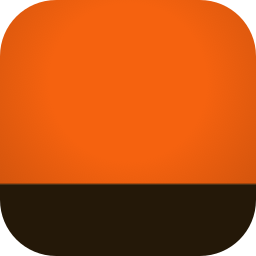
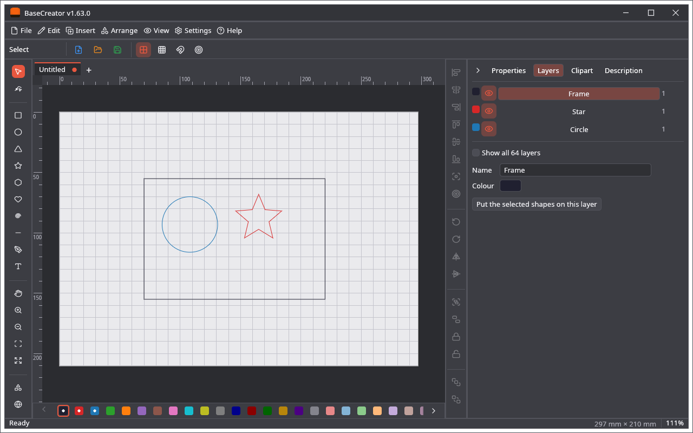

🌐 [English](Home) · **Polski**

# BaseCreator

Otwartoźródłowy program do rysowania napisany w Ruście, bez żadnej części maszynowej: bez urządzeń, połączeń, G-code i kamery. Zapisuje te same pliki projektu (`.cre`) co [LightCreator](https://github.com/michalsarna/LightCreator) (laser), [MillCreator](https://github.com/michalsarna/MillCreator) (frezarka CNC) i [PenCreator](https://github.com/michalsarna/PenCreator) (ploter), więc rysunek można zrobić tutaj, a przygotować dla maszyny tam.

## Od czego zacząć

| Chcę… | Zobacz |
|---|---|
| Zainstalować program | [Instalacja](Instalacja) |
| Zrobić pierwszy rysunek, krok po kroku | [Szybki start](Szybki-start) |
| Ustawić rozmiar strony, używać warstw | [Strona i warstwy](Strona-i-warstwy) |
| Edytować kształty, wektoryzować obrazy, robić kopie | [Narzędzia projektowe](Narzedzia-projektowe) |
| Czytać lub zapisywać inne formaty plików | [Import i eksport](Import-i-eksport) |
| Ułożyć obszar roboczy: panele i karty | [Panele i karty](Panele-i-karty) |
| Znaleźć polecenie w menu | [Menu](Menu) |
| Poznać skróty | [Skróty klawiszowe](Skroty-klawiszowe) |
| Dzielić projekt z innymi programami | [Plik projektu](Plik-projektu) |
| Zobaczyć, jak to wygląda | [Zrzuty ekranu](Zrzuty-ekranu) |
| Dodać generatory i importery | [Wtyczki](Wtyczki) |
| Znaleźć plik ustawień | [Ustawienia i pliki](Ustawienia-i-pliki) |
| Poczytać o kodzie | [Architektura](Architektura) |
| Wiedzieć, czego nie ma | [Ograniczenia](Ograniczenia) |

## W skrócie

* **Edytor:** kształty, edycja węzłów, linie Béziera, tekst, grupowanie, wyrównywanie, operacje logiczne, offset, zaokrąglanie narożników, obrazy i wektoryzacja, cofanie, siatka i przyciąganie. Rysunki są kartami, w maksymalnie trzech panelach.
* **Strona** zamiast pola roboczego maszyny: typowe arkusze, własny rozmiar, pion i poziom, mm lub cale.
* **64 warstwy**, każda to grupa kształtów z nazwą i kolorem, którą można ukryć.
* **Import:** obraz, SVG, Adobe Illustrator / PDF, DXF, projekt LightBurn, projekt UGS oraz to, co czytają wtyczki. **Eksport:** SVG, PLT, DXF.
* **Plik projektu:** `.cre`, wspólny z trzema pozostałymi programami; ich sekcje zostają w pliku po zapisie tutaj.
* **Cliparty:** 310 obrazków wspólnych z innymi programami, z wyszukiwaniem w internecie.
* **Interfejs:** 30 języków i 14 schematów kolorów; w okolicach Bożego Narodzenia, Nowego Roku, Halloween i Wielkanocy także świąteczna ikona i dwa świąteczne schematy.

Wydania mają numery tagów repozytorium, dlatego różnią się od numerów pozostałych programów.

Najnowsza wersja: **v1.63.0** · [Wydania](https://github.com/michalsarna/baseCreator/releases) · [Zgłoszenia](https://github.com/michalsarna/baseCreator/issues) · Licencja: [MIT](https://github.com/michalsarna/baseCreator/blob/main/LICENSE) lub [Apache-2.0](https://github.com/michalsarna/baseCreator/blob/main/LICENSE-APACHE), do wyboru
