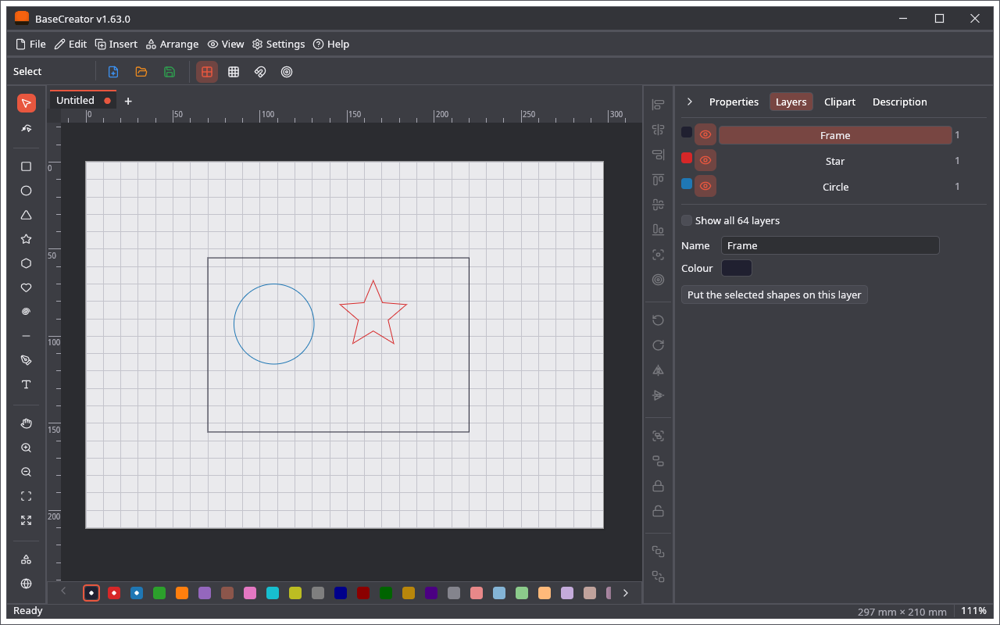

🌐 [English](Home) · [Polski](Home-PL) · **简体中文** · [한국어](Home-KO)

> ⚠️ 本页由英文版机器翻译而成，可能有不准确之处。如有疑问，请以[英文版](Home)为准。欢迎提出修改建议。

# BaseCreator

一款用 Rust 编写的开源绘图程序，不涉及任何机器：没有设备、连接、G-code，也没有摄像头。它写出的项目文件（`.cre`）与 [LightCreator](https://github.com/michalsarna/LightCreator)（激光）、[MillCreator](https://github.com/michalsarna/MillCreator)（CNC 铣床）和 [PenCreator](https://github.com/michalsarna/PenCreator)（笔式绘图仪）相同，因此可以在这里画图，再到那些程序中为机器完成后续处理。

## 从哪里开始

| 我想要…… | 前往 |
|---|---|
| 安装程序 | [安装](Installation-ZH) |
| 一步步完成第一幅图 | [快速入门](Quick-Start-ZH) |
| 设置页面大小、使用图层 | [页面与图层](Page-and-Layers-ZH) |
| 编辑形状、描摹图片、制作副本 | [设计工具](Design-Tools-ZH) |
| 用某种风格的线条重绘图片（点画、波浪线、排线……） | [风格描摹](Style-Trace-ZH) |
| 读取或写出其他文件格式 | [导入与导出](Import-and-Export-ZH) |
| 安排工作区：窗格与标签页 | [窗格与标签页](Panes-and-Tabs-ZH) |
| 在菜单中查找命令 | [菜单](Menus-ZH) |
| 学习快捷键 | [键盘快捷键](Keyboard-Shortcuts-ZH) |
| 与其他程序共享项目 | [项目文件](Project-File-ZH) |
| 看看程序的样子 | [截图](Screenshots-ZH) |
| 添加生成器和导入器 | [插件](Plugins-ZH) |
| 找到设置文件 | [设置与文件](Settings-and-Files-ZH) |
| 了解代码 | [架构](Architecture-ZH) |
| 了解缺少哪些功能 | [限制](Limitations-ZH) |

## 概览

* **编辑器**：形状、节点编辑、贝塞尔线、文字、编组、对齐、布尔运算、偏移、圆角、图片与描摹、撤销、网格与吸附。每幅图是一个标签页，最多可分布在三个窗格中。
* **页面**代替机器的工作区：常用纸张、自定义尺寸、纵向和横向、毫米或英寸。
* **64 个图层**，每个图层是一组形状，带有名称和颜色，可以隐藏。
* **导入**：图像、SVG、Adobe Illustrator / PDF / EPS / VectorCraft、DXF、LightBurn 项目、UGS 设计，以及插件能读取的格式。**导出**：SVG、PLT、DXF。
* **项目文件**：`.cre`，与另外三个程序共享；在这里保存时，它们的部分会保留在文件中。
* **剪贴画**：与其他程序共享的 310 幅图片，并可在线搜索。
* **界面**：38 种语言和 18 种配色方案；在圣诞节、新年、万圣节、复活节和春节前后，还有节日图标和两种节日配色方案。

版本号沿用本仓库的标签编号，因此与其他程序的版本号不同。

最新版本：**v1.63.0** · [发布](https://github.com/michalsarna/baseCreator/releases) · [问题](https://github.com/michalsarna/baseCreator/issues) · 许可证：[MIT](https://github.com/michalsarna/baseCreator/blob/main/LICENSE) 或 [Apache-2.0](https://github.com/michalsarna/baseCreator/blob/main/LICENSE-APACHE)，任选其一
