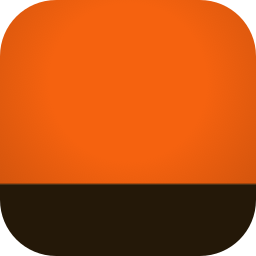
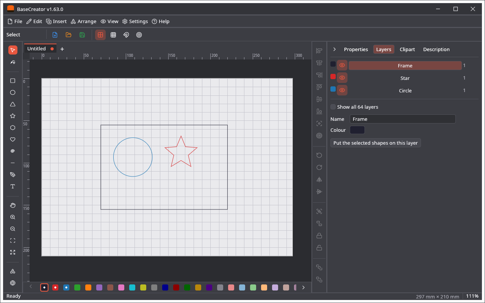

🌐 **English** · [Polski](Home-PL)

# BaseCreator

An open-source drawing program written in Rust, with nothing of a machine: no devices, connections, G-code or camera. It writes the same project files (`.cre`) as [LightCreator](https://github.com/michalsarna/LightCreator) (laser), [MillCreator](https://github.com/michalsarna/MillCreator) (CNC mill) and [PenCreator](https://github.com/michalsarna/PenCreator) (pen plotter), so a drawing can be made here and finished for a machine there.

## Where to start

| I want to… | Go to |
|---|---|
| Install the program | [Installation](Installation) |
| Make a first drawing, step by step | [Quick Start](Quick-Start) |
| Set the size of the page, use layers | [Page and Layers](Page-and-Layers) |
| Edit shapes, trace pictures, make copies | [Design Tools](Design-Tools) |
| Draw a picture as lines in a style (stippling, squiggles, hatching…) | [Style Trace](Style-Trace) |
| Read or write other file formats | [Import and Export](Import-and-Export) |
| Arrange the work area: panes and tabs | [Panes and Tabs](Panes-and-Tabs) |
| Find a command in the menus | [Menus](Menus) |
| Learn the keys | [Keyboard Shortcuts](Keyboard-Shortcuts) |
| Share a project with the other programs | [Project File](Project-File) |
| See what it looks like | [Screenshots](Screenshots) |
| Add generators and importers | [Plugins](Plugins) |
| Find the settings file | [Settings and Files](Settings-and-Files) |
| Read about the code | [Architecture](Architecture) |
| Know what is not there | [Limitations](Limitations) |

## At a glance

* **Editor:** shapes, node editing, Bézier lines, text, grouping, aligning, boolean operations, offset, rounded corners, pictures and tracing, undo, grid and snapping. Drawings are tabs, in up to three panes.
* **A page** in place of the work area of a machine: the usual sheets, a size of your own, portrait and landscape, mm or inches.
* **64 layers**, each a group of shapes with a name and a colour, which can be hidden.
* **Import:** image, SVG, Adobe Illustrator / PDF, DXF, LightBurn project, UGS design, and what plugins read. **Export:** SVG, PLT, DXF.
* **Project file:** `.cre`, shared with the three other programs; their sections stay in the file when you save here.
* **Clipart:** 310 pictures shared with the other programs, with online search.
* **Interface:** 30 languages and 18 colour schemes; around Christmas, the New Year, Halloween and Easter also a festive icon and two festive schemes.

Releases have the numbers of the tags of the repository, which is why the numbers differ from those of the other programs.

Latest release: **v1.63.0** · [Releases](https://github.com/michalsarna/baseCreator/releases) · [Issues](https://github.com/michalsarna/baseCreator/issues) · Licence: [MIT](https://github.com/michalsarna/baseCreator/blob/main/LICENSE) or [Apache-2.0](https://github.com/michalsarna/baseCreator/blob/main/LICENSE-APACHE), at your option
