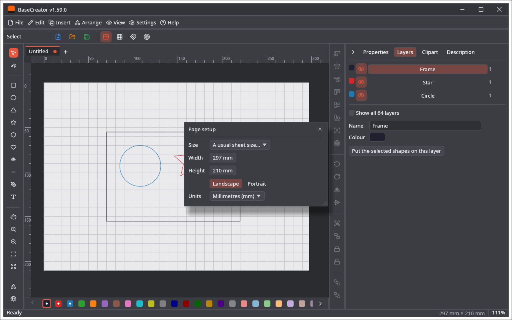

🌐 [English](Page-and-Layers) · [Polski](Strona-i-warstwy) · [简体中文](Page-and-Layers-ZH) · **한국어**

# 페이지와 레이어

## 페이지

다른 프로그램에는 기계의 작업 영역이 있습니다. BaseCreator에는 **페이지**가 있습니다: **파일 → 페이지 설정…**(**File → Page setup…**)을 선택하거나 상태 표시줄에서 페이지 크기를 클릭합니다.

* **크기**(**Size**): A5, A4, A3, A2, A1, Letter, Legal.
* **너비**(**Width**)와 **높이**(**Height**): 10 mm부터 10 m까지 아무 크기나 가능합니다.
* **가로**(**Landscape**)와 **세로**(**Portrait**)는 페이지 방향을 돌립니다. 크기는 그대로입니다.
* **단위**(**Units**): 프로그램 입력란에 쓰이는 단위입니다.

페이지는 프로젝트에 저장됩니다. 그림마다 자신의 페이지를 가지며, 다음 새 그림에는 마지막으로 설정한 크기가 주어집니다. 다른 프로그램에서 만든 프로젝트에는 BaseCreator의 페이지가 없으므로, 마지막 새 그림의 페이지가 주어지고 그림이 들어가지 않으면 더 크게 만들어집니다.

## 레이어

레이어는 64개입니다. 여기서 레이어는 이름과 색이 있는 도형 그룹이며 숨길 수 있습니다. 기계에 관한 정보는 담지 않습니다.

* 작업 영역 아래의 **색 줄**에 모든 레이어가 있으며, 도형이 있는 레이어에는 점이 표시됩니다. 클릭하면 선택한 도형이 그 레이어로 이동하고, 더블 클릭하면 **레이어**(**Layers**) 탭에서 그 레이어가 열립니다.
* **레이어 탭**에는 도형이 있는 레이어와 사용 중인 레이어가 나열됩니다(*64개 레이어 모두 표시*(*Show all 64 layers*)를 켜면 전부 나열됩니다). 각 레이어에는 색, 표시/숨기기용 눈 아이콘, 이름, 도형 수가 있습니다. 아래에는 선택한 레이어의 **이름**(**Name**)과 **색**(**Colour**), 그리고 **선택한 도형을 이 레이어에 배치**(**Put the selected shapes on this layer**)가 있습니다.
* 새 도형은 사용 중인 레이어에 들어갑니다.
* **설정 → 보기 옵션… → 레이어 이름 표시**(**Settings → View options… → Show layer names**)를 켜면 색 줄에서 색 옆에 이름이 표시됩니다.

레이어는 프로젝트에 저장됩니다. 다른 프로그램에는 자체 레이어가 있습니다. 여기의 레이어가 레이저의 커팅 설정이나 플로터의 펜을 바꾸지는 않지만, 도형은 그곳에서도 레이어 번호를 유지합니다. [프로젝트 파일](Project-File-KO)을 참고하십시오.
