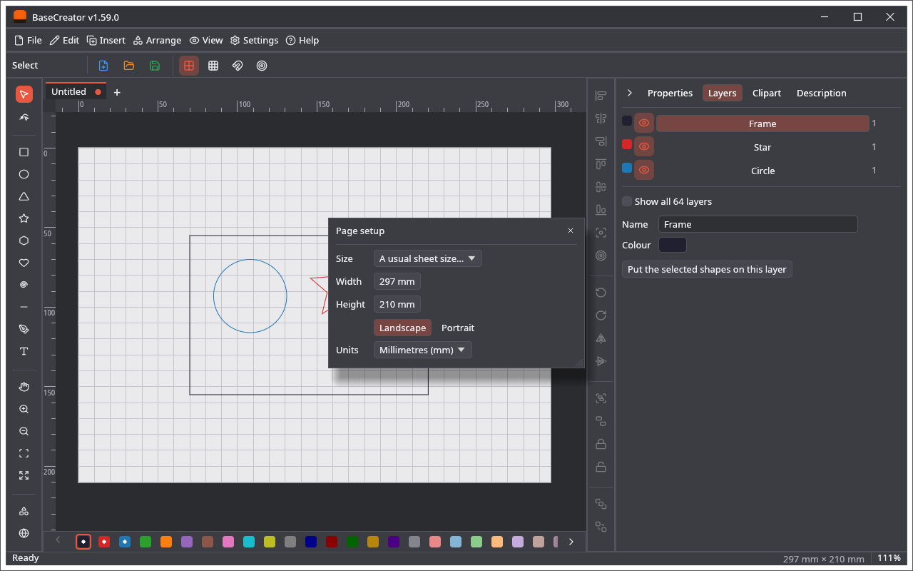

🌐 [English](Page-and-Layers) · [Polski](Strona-i-warstwy) · **简体中文** · [한국어](Page-and-Layers-KO)

# 页面与图层

## 页面

其他程序使用机器的工作区。BaseCreator 使用的是**页面**：**文件 → 页面设置…**（**File → Page setup…**），或点击状态栏中的页面尺寸。

* **尺寸**（**Size**）：A5、A4、A3、A2、A1、Letter、Legal。
* **宽度**（**Width**）和**高度**（**Height**）：10 mm 到 10 m 之间的任意尺寸。
* **横向**（**Landscape**）和**纵向**（**Portrait**）用于旋转页面；尺寸保持不变。
* **单位**（**Units**）：程序中各字段使用的单位。

页面保存在项目中。每幅图都保留自己的页面，下一幅新图会使用你最后设置的尺寸。在其他程序中创建的项目没有 BaseCreator 的页面：它会得到最近一幅新图的页面，如果图纸放不下，页面会相应放大。

## 图层

共有 64 个图层。这里的图层是一组形状，带有名称和颜色，并且可以隐藏。它与机器无关。

* **颜色行**位于工作区下方，包含所有图层；带圆点的表示其中有形状。单击会把所选形状放到该图层上，双击会在**图层**（**Layers**）标签页中打开该图层。
* **图层标签页**列出有形状的图层和当前使用的图层（*显示全部 64 个图层*（*Show all 64 layers*）会列出所有图层），每个图层显示其颜色、用于显示或隐藏的眼睛图标、名称以及形状数量。下方是所选图层的**名称**（**Name**）和**颜色**（**Colour**），以及**将所选形状放到此图层**（**Put the selected shapes on this layer**）。
* 新形状会放到当前使用的图层上。
* **设置 → 视图选项… → 显示图层名称**（**Settings → View options… → Show layer names**）会在颜色行中的颜色旁写出图层名称。

图层保存在项目中。其他程序有它们自己的图层：这里的图层不会改变激光的切割设置或绘图仪的笔，但形状在那里会保留它的图层编号。参见[项目文件](Project-File-ZH)。
