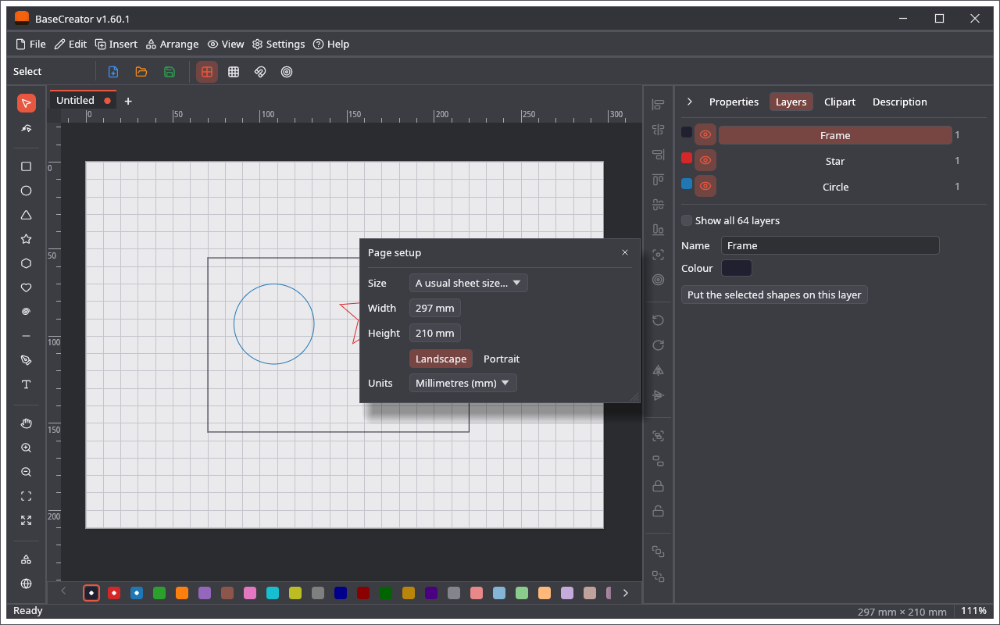

🌐 **English** · [Polski](Strona-i-warstwy)

# Page and Layers

## The page

The other programs have the work area of a machine. BaseCreator has a **page**: **File → Page setup…**, or a click on its size in the status bar.

* **Size:** A5, A4, A3, A2, A1, Letter, Legal.
* **Width** and **Height:** any size from 10 mm to 10 m.
* **Landscape** and **Portrait** turn the page; the sizes stay.
* **Units:** the units of the fields of the program.

The page is saved in the project. Every drawing keeps its own page, and the next new drawing gets the size you set last. A project made in another program has no page of BaseCreator: it gets the page of the last new drawing, made bigger when the drawing does not fit.

## Layers

There are 64 layers. A layer here is a group of shapes with a name and a colour, and it can be hidden. It says nothing about a machine.

* **The row of colours** under the work area has all the layers; a dot marks those with shapes. A click puts the selected shapes on that layer, a double click opens it in the **Layers** tab.
* **The Layers tab** lists the layers with shapes and the one in use (*Show all 64 layers* lists them all), each with its colour, an eye to show or hide it, its name and the number of its shapes. Below are the **Name** and the **Colour** of the layer that is chosen, and **Put the selected shapes on this layer**.
* New shapes go on the layer in use.
* **Settings → View options… → Show layer names** writes the names beside the colours in the row.

Layers are saved in the project. The other programs have layers of their own: a layer here does not change the cuts of a laser or the pens of a plotter, but a shape keeps its layer number there. See [Project File](Project-File).
