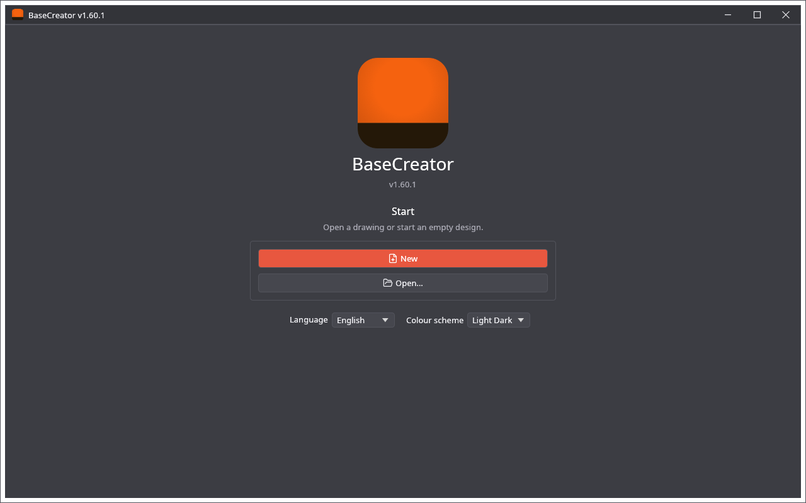

🌐 [English](Quick-Start) · [Polski](Szybki-start) · [简体中文](Quick-Start-ZH) · **한국어**

> ⚠️ 이 페이지는 영어판을 기계 번역한 것으로, 부정확한 부분이 있을 수 있습니다. 의심스러우면 [영어판](Quick-Start)을 기준으로 하십시오. 수정 제안을 환영합니다.

# 빠른 시작

처음부터 끝까지 첫 그림 만들기: 페이지를 고르고, 무언가를 그리거나 가져오고, 도형을 레이어에 배치하고, 프로젝트를 저장한 뒤 내보냅니다.

## 1. 시작

시작 화면에는 **새로 만들기**(**New**), **열기…**(**Open…**)와 최근 파일이 있고, 그 아래에 언어와 색 구성표가 있습니다. **새로 만들기**를 누르십시오. 고를 장치는 없습니다. 그림에는 페이지가 주어지는데, 처음에는 긴 쪽으로 눕힌 A4이고 그다음부터는 마지막으로 사용한 크기입니다.

## 2. 페이지 고르기

**파일 → 페이지 설정…**(**File → Page setup…**)을 선택하거나 아래쪽 상태 표시줄에서 페이지 크기를 클릭하면 페이지 창이 열립니다. 일반적인 용지, 직접 정한 너비와 높이, **가로**(**Landscape**) 또는 **세로**(**Portrait**), 그리고 단위를 정합니다. 그림마다 자신의 페이지를 가집니다. [페이지와 레이어](Page-and-Layers-KO)를 참고하십시오.

## 3. 그리기

왼쪽 팔레트에서 도구를 고르거나 해당 글자 키를 누릅니다: **R** 사각형, **E** 타원, **L** 선, **P** 폴리라인, **T** 텍스트, **V** 선택으로 돌아가기. 페이지 위에서 끌어 그립니다. 오른쪽의 **속성**(**Properties**) 탭에는 선택한 것의 위치와 크기가 표시됩니다. 모든 도구: [디자인 도구](Design-Tools-KO).

또는 무언가를 가져올 수 있습니다. **파일 → 가져오기 → SVG 가져오기…**(**File → Import → Import SVG…**)는 파일의 경로를 그림에 추가하고, **클립아트**(**Clipart**) 탭에는 미리 만들어진 그림이 있습니다. 모든 형식: [가져오기와 내보내기](Import-and-Export-KO).

## 4. 도형을 레이어에 배치하기

작업 영역 아래의 색 줄에 64개의 레이어가 있습니다. 도형을 선택하고 색을 클릭하면 그 레이어로 이동하며, 새 도형은 사용 중인 레이어에 들어갑니다. **레이어**(**Layers**) 탭에서 레이어에 이름과 색을 지정하고 숨길 수 있습니다.

## 5. 저장

**파일 → 저장**(**File → Save**, Ctrl+S)은 `.cre` 프로젝트를 저장합니다. 그 후에는 변경 후 약 20초가 지나면 프로그램이 스스로 저장합니다.

## 6. 그림 사용하기

* `.cre`를 LightCreator, MillCreator 또는 PenCreator에서 열어 기계용으로 준비합니다. [프로젝트 파일](Project-File-KO)을 참고하십시오.
* 또는 다른 프로그램용으로 저장합니다: **파일 → 내보내기 → SVG 내보내기…**(**File → Export → Export SVG…**) 또는 **PLT / DXF 내보내기…**(**Export PLT / DXF…**).
