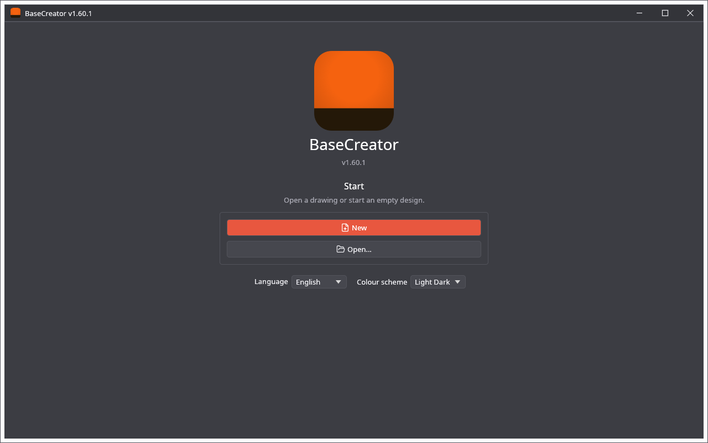

🌐 [English](Quick-Start) · [Polski](Szybki-start) · **简体中文** · [한국어](Quick-Start-KO)

# 快速入门

从头到尾完成第一幅图：选择页面，绘制或导入内容，把形状放到图层上，保存项目并导出。

## 1. 启动

启动界面上有 **新建**（**New**）、**打开…**（**Open…**）和最近使用的文件，下方是语言和配色方案。按 **新建**。这里无需选择设备：图纸会得到一个页面，第一次是横放的 A4，之后是你上次使用的尺寸。

## 2. 选择页面

**文件 → 页面设置…**（**File → Page setup…**），或点击底部状态栏中的页面尺寸，即可打开页面窗口：常用纸张、自定义宽度和高度、**横向**（**Landscape**）或 **纵向**（**Portrait**），以及单位。每幅图都保留自己的页面。参见[页面与图层](Page-and-Layers-ZH)。

## 3. 绘图

在左侧的工具栏中选择工具，或按它的字母键：**R** 矩形，**E** 椭圆，**L** 直线，**P** 折线，**T** 文字，**V** 返回选择。在页面上拖动。右侧的 **属性**（**Properties**）标签页显示所选对象的位置和尺寸。全部工具：[设计工具](Design-Tools-ZH)。

或者导入内容：**文件 → 导入 → 导入 SVG…**（**File → Import → Import SVG…**）会把文件中的路径添加到图纸中，**剪贴画**（**Clipart**）标签页里有现成的图片。全部格式：[导入与导出](Import-and-Export-ZH)。

## 4. 把形状放到图层上

工作区下方的颜色行包含 64 个图层。选中形状后点击一个颜色：形状就会移到该图层；新形状会放到当前使用的图层上。**图层**（**Layers**）标签页可以为图层设置名称和颜色，也可以隐藏图层。

## 5. 保存

**文件 → 保存**（**File → Save**，Ctrl+S）会写出一个 `.cre` 项目。之后，每次更改约 20 秒后程序会自动保存。

## 6. 使用图纸

* 在 LightCreator、MillCreator 或 PenCreator 中打开 `.cre`，为机器做准备。参见[项目文件](Project-File-ZH)。
* 或者为其他程序写出文件：**文件 → 导出 → 导出 SVG…**（**File → Export → Export SVG…**）或 **导出 PLT / DXF…**（**Export PLT / DXF…**）。
