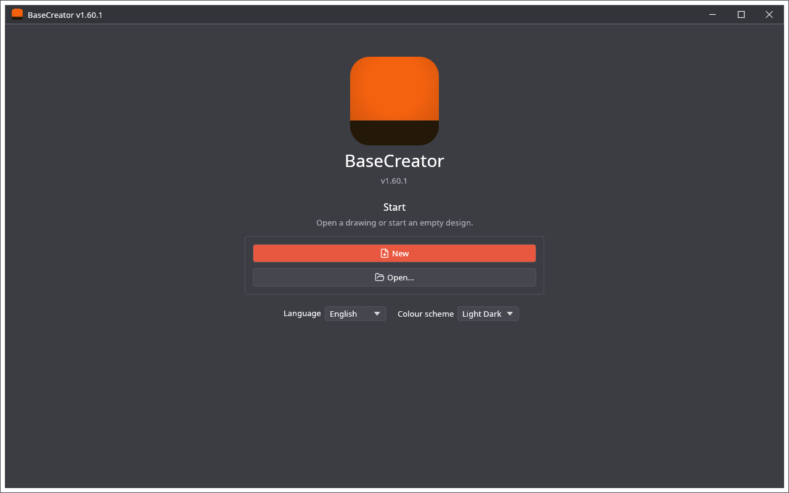

🌐 **English** · [Polski](Szybki-start)

# Quick Start

A first drawing from start to end: choose the page, draw or import something, put the shapes on layers, save the project and export it.

## 1. Start

The start screen has **New**, **Open…** and the recent files, and below them the language and the colour scheme. Press **New**. There is no device to choose: the drawing gets a page, A4 lying on its long side the first time, then the size you used last.

## 2. Choose the page

**File → Page setup…**, or a click on the size of the page in the status bar at the bottom, opens the window of the page: a usual sheet, your own width and height, **Landscape** or **Portrait**, and the units. Every drawing keeps its own page. See [Page and Layers](Page-and-Layers).

## 3. Draw

Choose a tool in the palette at the left, or press its letter: **R** rectangle, **E** ellipse, **L** line, **P** polyline, **T** text, **V** back to selecting. Drag on the page. The **Properties** tab at the right shows the position and the size of what is selected. All the tools: [Design Tools](Design-Tools).

Or bring something in: **File → Import → Import SVG…** adds the paths of a file to the drawing, and the **Clipart** tab has ready-made pictures. All the formats: [Import and Export](Import-and-Export).

## 4. Put the shapes on layers

The row of colours under the work area has the 64 layers. Select shapes and click a colour: they go to that layer, and a new shape goes to the layer in use. The **Layers** tab gives a layer a name and a colour and hides it.

## 5. Save

**File → Save** (Ctrl+S) writes a `.cre` project. After that the program saves it by itself about 20 seconds after a change.

## 6. Use the drawing

* Open the `.cre` in LightCreator, MillCreator or PenCreator to prepare it for a machine. See [Project File](Project-File).
* Or write it for other programs: **File → Export → Export SVG…** or **Export PLT / DXF…**.
