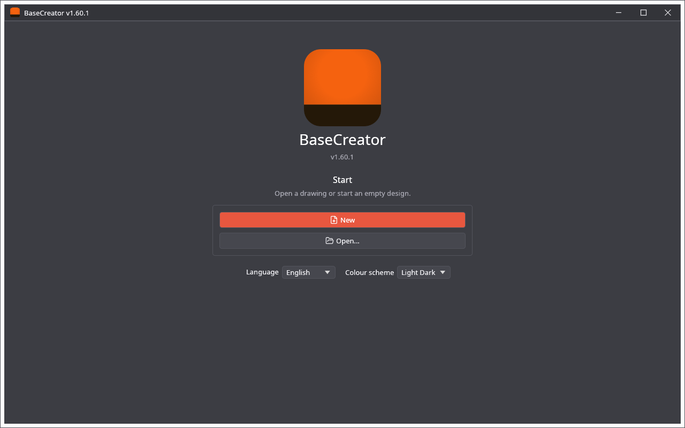
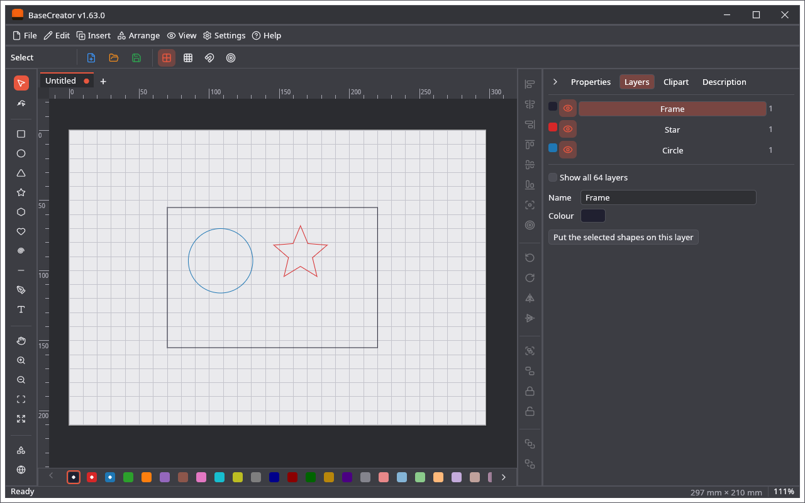
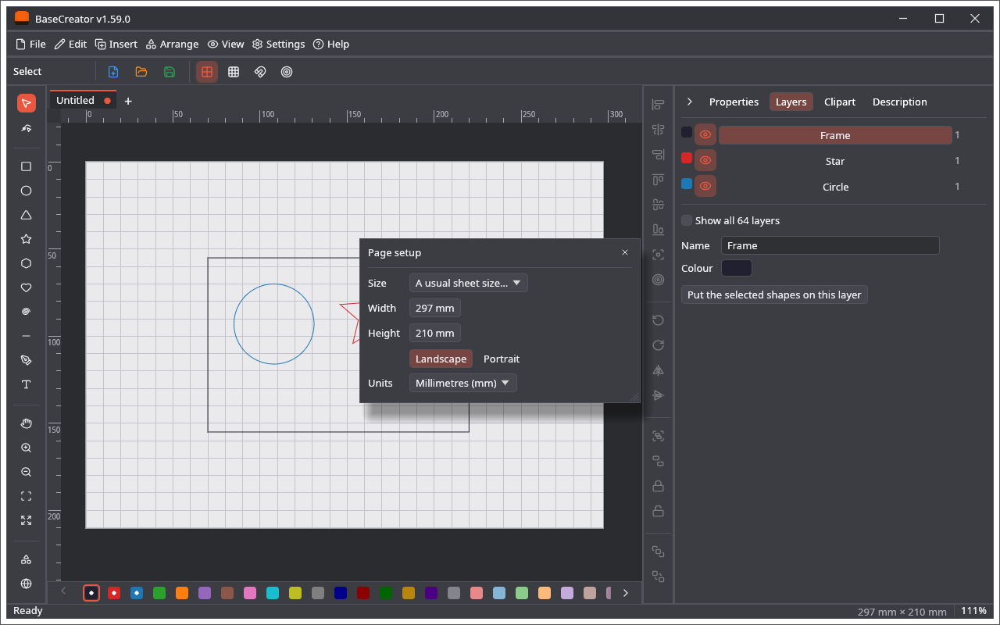

🌐 [English](Screenshots) · [Polski](Zrzuty-ekranu) · [简体中文](Screenshots-ZH) · **한국어**

# 스크린샷

그림은 프로그램이 스스로 만듭니다: `cargo test -p basecreator render_screenshots -- --ignored`.

## 시작 화면

## 레이어 탭이 열린 편집기

## 페이지 설정

