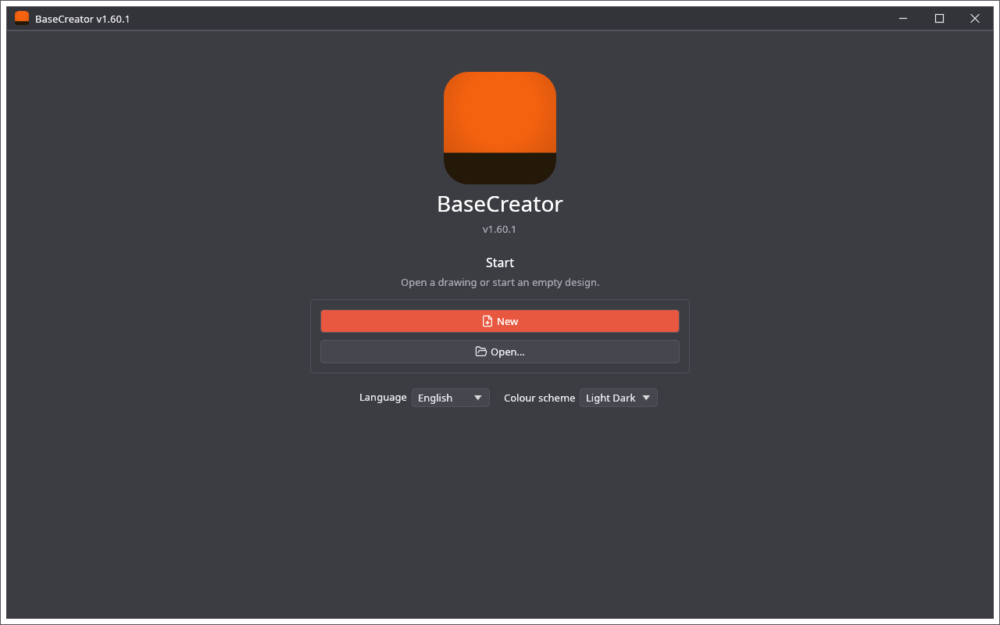
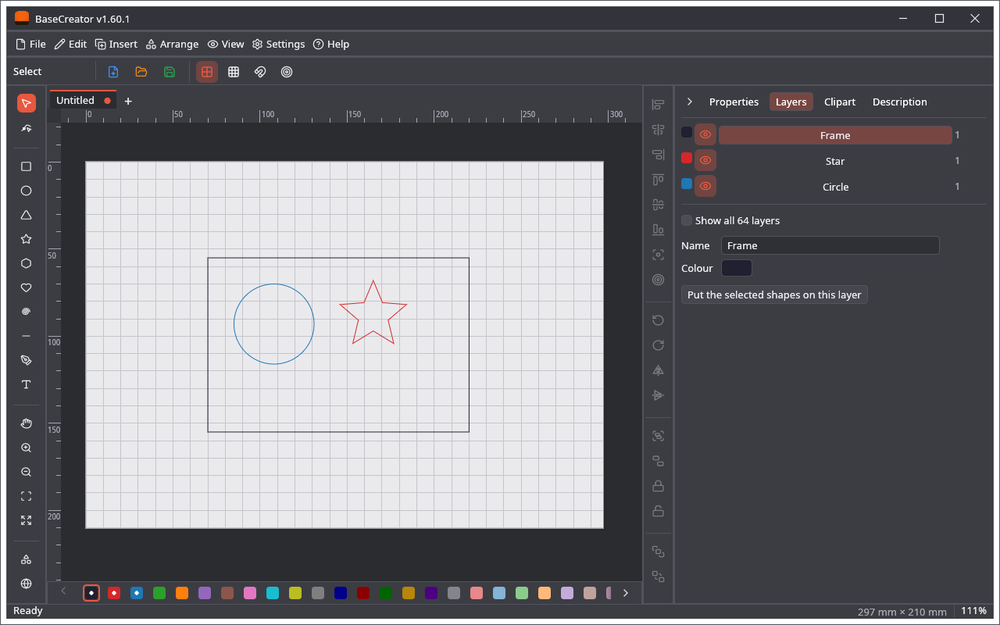
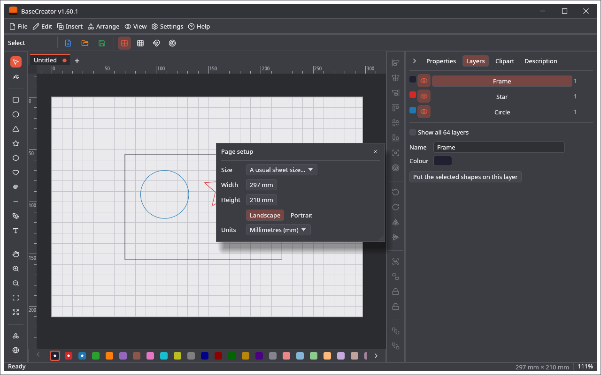

🌐 **English** · [Polski](Zrzuty-ekranu)

# Screenshots

The pictures are made by the program itself: `cargo test -p basecreator render_screenshots -- --ignored`.

## Start screen

## The editor, with the Layers tab

## Page setup

