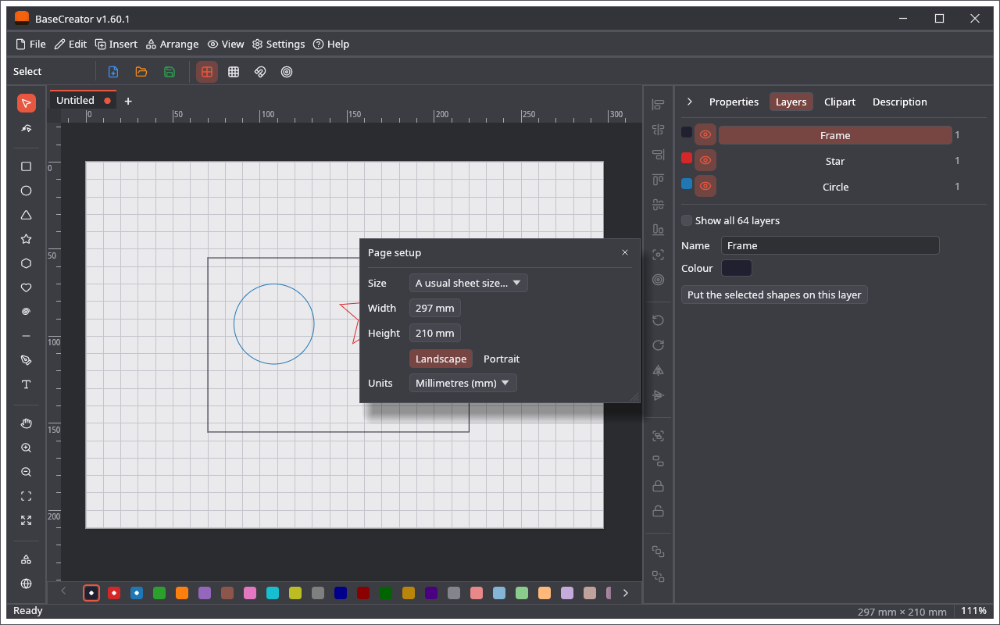

🌐 [English](Page-and-Layers) · **Polski**

# Strona i warstwy

## Strona

Pozostałe programy mają pole robocze maszyny. BaseCreator ma **stronę**: **Plik → Ustawienia strony…** albo kliknięcie jej rozmiaru na pasku stanu.

* **Rozmiar:** A5, A4, A3, A2, A1, Letter, Legal.
* **Szerokość** i **Wysokość:** dowolny rozmiar od 10 mm do 10 m.
* **Poziomo** i **Pionowo** obracają stronę; wymiary zostają.
* **Jednostki:** jednostki pól w programie.

Strona jest zapisywana w projekcie. Każdy rysunek ma własną stronę, a następny nowy rysunek dostaje ostatnio ustawiony rozmiar. Projekt z innego programu nie ma strony BaseCreatora: dostaje stronę ostatniego nowego rysunku, powiększoną, gdy rysunek się nie mieści.

## Warstwy

Warstw jest 64. Warstwa to tutaj grupa kształtów z nazwą i kolorem, którą można ukryć. Nie mówi niczego o maszynie.

* **Rząd kolorów** pod obszarem roboczym ma wszystkie warstwy; kropka oznacza te z kształtami. Kliknięcie przenosi zaznaczone kształty na tę warstwę, a podwójne kliknięcie otwiera ją w karcie **Warstwy**.
* **Karta Warstwy** pokazuje warstwy z kształtami i warstwę używaną (*Pokaż wszystkie warstwy (64)* pokazuje wszystkie), każdą z kolorem, okiem do pokazywania i ukrywania, nazwą i liczbą kształtów. Niżej są **Nazwa** i **Kolor** wybranej warstwy oraz **Umieść zaznaczone kształty na tej warstwie**.
* Nowe kształty trafiają na warstwę używaną.
* **Ustawienia → Opcje widoku… → Pokaż nazwy warstw** dopisuje nazwy obok kolorów w rzędzie.

Warstwy są zapisywane w projekcie. Pozostałe programy mają własne warstwy: warstwa tutaj nie zmienia cięć lasera ani pisaków plotera, ale kształt zachowuje tam numer warstwy. Zobacz [Plik projektu](Plik-projektu).
