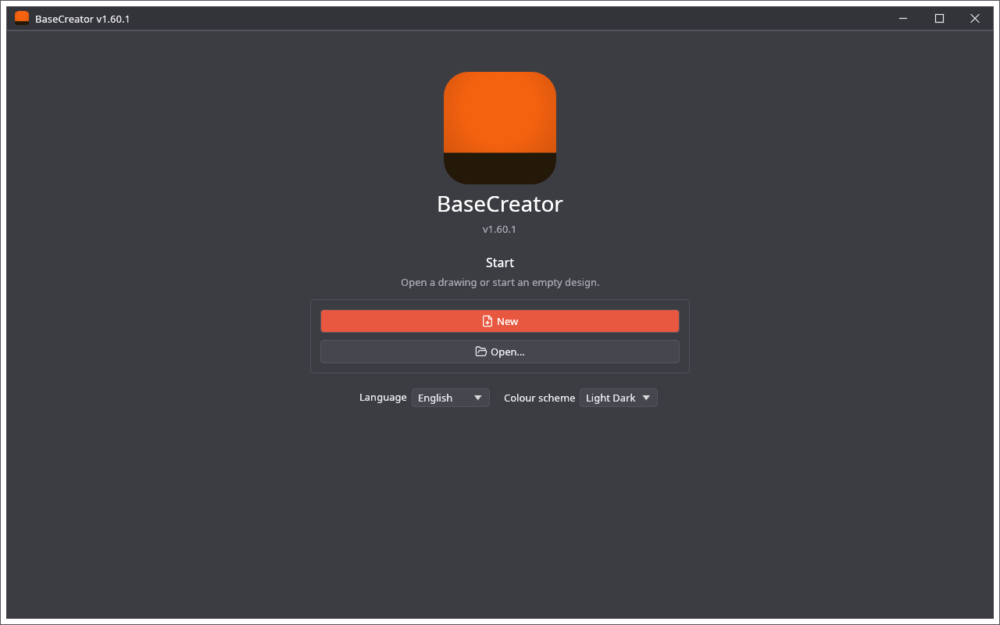

🌐 [English](Quick-Start) · **Polski**

# Szybki start

Pierwszy rysunek od początku do końca: wybierz stronę, narysuj lub zaimportuj coś, ułóż kształty na warstwach, zapisz projekt i wyeksportuj go.

## 1. Start

Ekran startowy ma **Nowy**, **Otwórz…** i ostatnie pliki, a pod nimi język i schemat kolorów. Naciśnij **Nowy**. Nie ma urządzenia do wyboru: rysunek dostaje stronę, za pierwszym razem A4 leżące na dłuższym boku, a potem ostatnio używany rozmiar.

## 2. Wybierz stronę

**Plik → Ustawienia strony…** albo kliknięcie rozmiaru strony na pasku stanu na dole otwiera okno strony: typowy arkusz, własna szerokość i wysokość, **Poziomo** lub **Pionowo** oraz jednostki. Każdy rysunek ma własną stronę. Zobacz [Strona i warstwy](Strona-i-warstwy).

## 3. Rysuj

Wybierz narzędzie z palety po lewej albo naciśnij jego literę: **R** prostokąt, **E** elipsa, **L** linia, **P** łamana, **T** tekst, **V** powrót do zaznaczania. Przeciągnij na stronie. Karta **Właściwości** po prawej pokazuje położenie i rozmiar zaznaczenia. Wszystkie narzędzia: [Narzędzia projektowe](Narzedzia-projektowe).

Możesz też coś wczytać: **Plik → Importuj → Importuj SVG…** dodaje ścieżki z pliku do rysunku, a karta **Clipart** ma gotowe obrazki. Wszystkie formaty: [Import i eksport](Import-i-eksport).

## 4. Ułóż kształty na warstwach

Rząd kolorów pod obszarem roboczym to 64 warstwy. Zaznacz kształty i kliknij kolor: przejdą na tę warstwę, a nowy kształt trafia na warstwę używaną. Karta **Warstwy** nadaje warstwie nazwę i kolor oraz ją ukrywa.

## 5. Zapisz

**Plik → Zapisz** (Ctrl+S) zapisuje projekt `.cre`. Potem program zapisuje go sam około 20 sekund po zmianie.

## 6. Użyj rysunku

* Otwórz `.cre` w LightCreatorze, MillCreatorze lub PenCreatorze, aby przygotować go dla maszyny. Zobacz [Plik projektu](Plik-projektu).
* Albo zapisz go dla innych programów: **Plik → Eksport → Eksportuj SVG…** lub **Eksportuj PLT / DXF…**.
