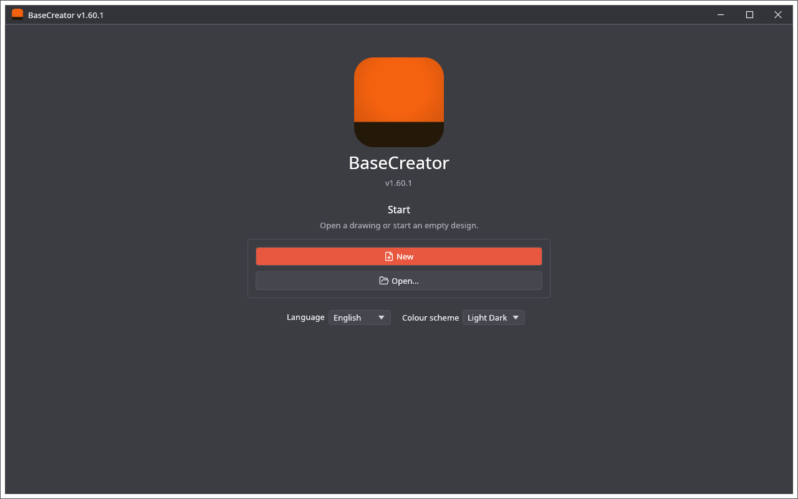
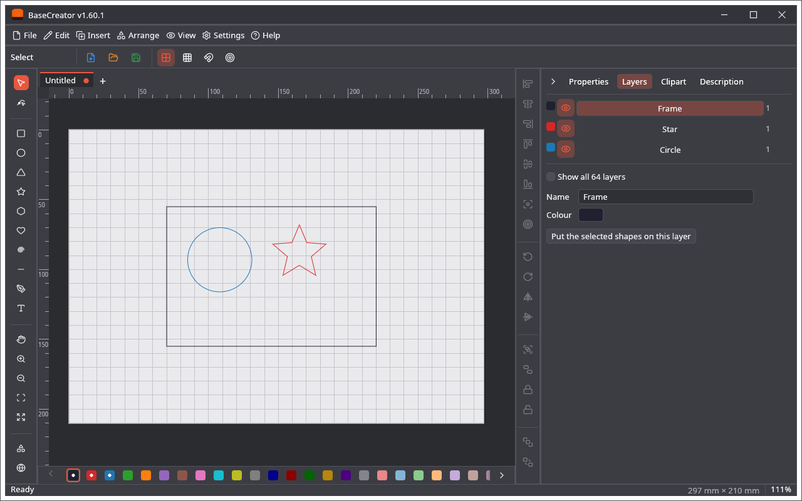
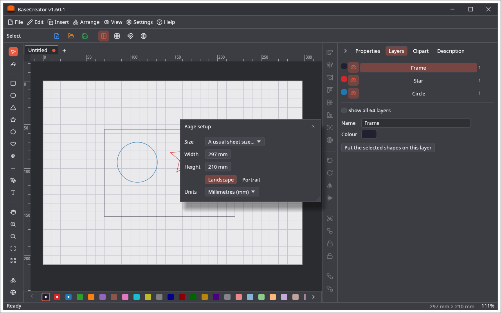

🌐 [English](Screenshots) · **Polski**

# Zrzuty ekranu

Obrazy robi sam program: `cargo test -p basecreator render_screenshots -- --ignored`.

## Ekran startowy

## Edytor z kartą Warstwy

## Ustawienia strony

